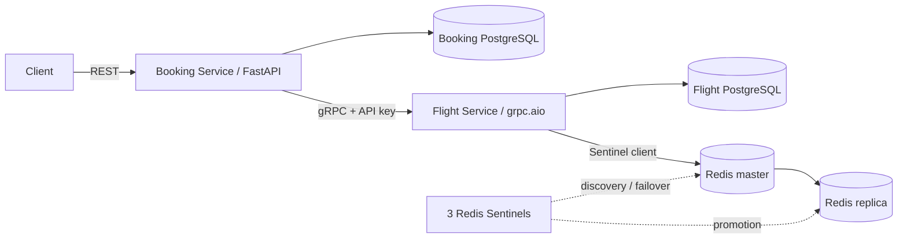

# Flight Booking

Два микросервиса на Python 3.13: Booking Service с FastAPI и Flight Service с асинхронным gRPC. У каждого сервиса собственная PostgreSQL. Flight Service использует Redis Cache-Aside с Sentinel. Реализованы все десять пунктов задания.

## Запуск

```bash
docker compose up --build -d --wait
```

Обычный `docker compose up` также собирает отсутствующие образы и запускает систему. Если установлен отдельный Compose CLI, подходит `docker-compose up`. Подготовка `.env` не требуется: локальные значения уже заданы в Compose. Для изменения настроек можно скопировать `.env.example` в `.env`.

- Swagger: http://localhost:8000/docs
- REST: http://localhost:8000
- gRPC: localhost:50051
- Состояние: `docker compose ps`
- Логи: `docker compose logs -f booking flight`
- Остановка с сохранением данных: `docker compose down`

Alembic применяет отдельную цепочку миграций каждого сервиса при запуске. `protoc` генерирует Python-контракт при сборке Docker-образа. PostgreSQL, Redis и Sentinel хранят состояние в именованных volumes. Проверки готовности задают порядок старта.

На первом запуске создаются четыре демонстрационных рейса на следующий день по UTC. Их ID оканчиваются на `0001`–`0004`; повторный запуск сохраняет существующие рейсы и бронирования. Дату можно увидеть через поиск без параметра date. `SEED_DEMO=false` отключает наполнение.

```bash
curl 'http://localhost:8000/flights?origin=SVO&destination=LED'

curl -X POST http://localhost:8000/bookings \
  -H 'Content-Type: application/json' \
  -d '{"user_id":"user-1","flight_id":"00000000-0000-0000-0000-000000000001","passenger_name":"Ivan Petrov","passenger_email":"ivan@example.com","seat_count":2}'

curl 'http://localhost:8000/bookings?user_id=user-1'

curl -X POST 'http://localhost:8000/bookings/BOOKING_ID/cancel'
```

Прямой gRPC-запрос при установленном grpcurl:

```bash
grpcurl -plaintext \
  -import-path proto -proto flight.proto \
  -H 'x-api-key: local-development-service-key' \
  -d '{"origin":"SVO","destination":"LED"}' \
  localhost:50051 flight.v1.FlightService/SearchFlights
```

## Архитектура



Схема в 3NF, ограничения и границы баз: [ER-диаграмма](docs/er.md). Форматы и коды ошибок: [контракты](docs/contracts.md).

ReserveSeats блокирует строку рейса через SELECT FOR UPDATE, проверяет доступность, уменьшает счётчик и создаёт резервацию в одной транзакции. Уникальный booking_id и транзакционная advisory-блокировка сериализуют повторы, в том числе запросы одного booking_id к разным рейсам. ReleaseReservation возвращает места и меняет статус атомарно, повторный вызов безопасен.

Booking Service сначала вызывает GetFlight, затем сохраняет намерение операции, вызывает ReserveSeats и записывает CONFIRMED с исторической стоимостью. При ошибке бронирование не создаётся. Если после резервирования произошёл сбой записи, выполняется компенсация. Сохранённые незавершённые операции подбирает фоновый процесс, в том числе после рестарта. Отмена также восстанавливается после сбоя между ReleaseReservation и записью CANCELLED. Блокировки операций предотвращают конкуренцию обработчика запроса и восстановления.

Между двумя PostgreSQL нет общей транзакции. Во время недоступности сервиса компенсация может быть отложена; после восстановления она доводит состояние до согласованного. Сохранённый запрет резервирования не даёт запоздавшему ReserveSeats снова занять возвращённые места.

## Кеш и отказоустойчивость

Ключи `flight:{id}` и `search:{origin}:{destination}:{date|all}` имеют TTL 300 секунд, настраиваемый до 600. При miss сервис читает рейсы из PostgreSQL и записывает ответ в Redis. ReserveSeats, ReleaseReservation и UpdateFlight удаляют затронутые ключи после коммита. В логах видны hit, miss и invalidation.

Каждая мутация также увеличивает версию кеша в PostgreSQL в той же транзакции. Перед чтением кеша сервис получает текущую версию и принимает только совпадающий ответ. Поэтому старое значение, записанное параллельным читателем или вернувшееся после переключения на отстающую реплику, не используется. Цена этой гарантии — один короткий запрос версии к БД на чтение; при любой мутации старые версии остальных ключей тоже становятся miss. Redis не требуется для корректности: при его недоступности запрос обслуживает PostgreSQL.

Sentinel-конфигурация: мастер, реплика и три Sentinel с кворумом 2. Клиент `redis.asyncio.sentinel.Sentinel` сам обнаруживает новый мастер. В контейнерах используются объявляемые DNS-имена, а переписанные Redis/Sentinel конфигурации сохраняются в volumes, чтобы рестарт сохранял роли. Настройки опираются на [документацию Redis Sentinel](https://redis.io/docs/latest/operate/oss_and_stack/management/sentinel/).

Retry и circuit breaker находятся в клиентском [gRPC AsyncIO interceptor](https://grpc.github.io/grpc/python/grpc_asyncio.html), отдельно от бизнес-логики. Не более трёх попыток с паузами 100 и 200 мс; повторяются только UNAVAILABLE и DEADLINE_EXCEEDED. Встроенные транспортные retries отключены. Каждая попытка имеет deadline, повторы ReserveSeats сохраняют booking_id.

Circuit breaker считает неудачные логические RPC после исчерпания повторов. По умолчанию пять последовательных ошибок в пределах 30 секунд открывают цепь на 15 секунд. OPEN немедленно возвращает HTTP 503. HALF_OPEN допускает ровно один RPC с одной попыткой; успех закрывает цепь, новая ошибка открывает её. Ответы предметной области подтверждают доступность сервиса и не учитываются как его отказ. Переходы состояний записываются в логи.

## Настройки

| Переменная | По умолчанию | Значение |
| --- | --- | --- |
| BOOKING_PORT / FLIGHT_PORT | 8000 / 50051 | Локальные порты |
| GRPC_API_KEY | local-development-service-key | Общий межсервисный ключ |
| BOOKING_DB_PASSWORD / FLIGHT_DB_PASSWORD | значения в .env.example | Пароли отдельных БД |
| GRPC_TIMEOUT | 2 | Deadline одной попытки, секунды |
| GRPC_MAX_ATTEMPTS | 3 | Число попыток, от 1 до 3 |
| GRPC_RETRY_BACKOFF | 0.1 | Начальная задержка, секунды |
| CIRCUIT_FAILURE_THRESHOLD | 5 | Порог неудачных RPC |
| CIRCUIT_RESET_TIMEOUT | 15 | Время OPEN, секунды |
| CIRCUIT_WINDOW | 30 | Окно подсчёта ошибок, секунды |
| CACHE_TTL | 300 | TTL кеша, 300–600 секунд |
| RECOVERY_INTERVAL | 2 | Период восстановления операций, секунды |
| SEED_DEMO | true | Первоначальные демонстрационные рейсы |
| LOG_LEVEL | INFO | Уровень логирования |

Внутри контейнеров дополнительно передаются DATABASE_URL, GRPC_TARGET, REDIS_SENTINELS, REDIS_MASTER_NAME и SERVICE. REST и gRPC опубликованы на loopback-интерфейсе; PostgreSQL и Redis доступны внутри Compose-сети.

## Проверки и локальная разработка

```bash
make test
```

Команда собирает и поднимает сервисы, затем запускает pytest в контейнере. Проверяются REST-сценарии, цена-снимок, валидация, авторизация всех RPC, конкуренция за последнее место, идемпотентность, ограничения БД, TTL, инвалидация, защита от устаревшего кеша, компенсация и восстановление отмены.

```bash
make resilience
```

Эта проверка временно останавливает текущий Redis-мастер и Flight Service в работающем Compose. Она проверяет автоматическое избрание мастера, обслуживание запросов без кеша, быстрый HTTP 503 при открытой цепи и восстановление через HALF_OPEN. В конце остановленные контейнеры запускаются обратно. Названия сервисов `redis-master` и `redis-replica` после failover могут не совпадать с текущими ролями.

```bash
make install
make unit
make lint
```

Для локальной разработки используется uv и `.venv`. `make install` устанавливает зафиксированные зависимости и генерирует gRPC-модули. Docker устанавливает те же версии из requirements.lock; дополнительные зависимости тестов находятся в requirements-dev.lock. Сгенерированный каталог `generated` не включается в Git.
