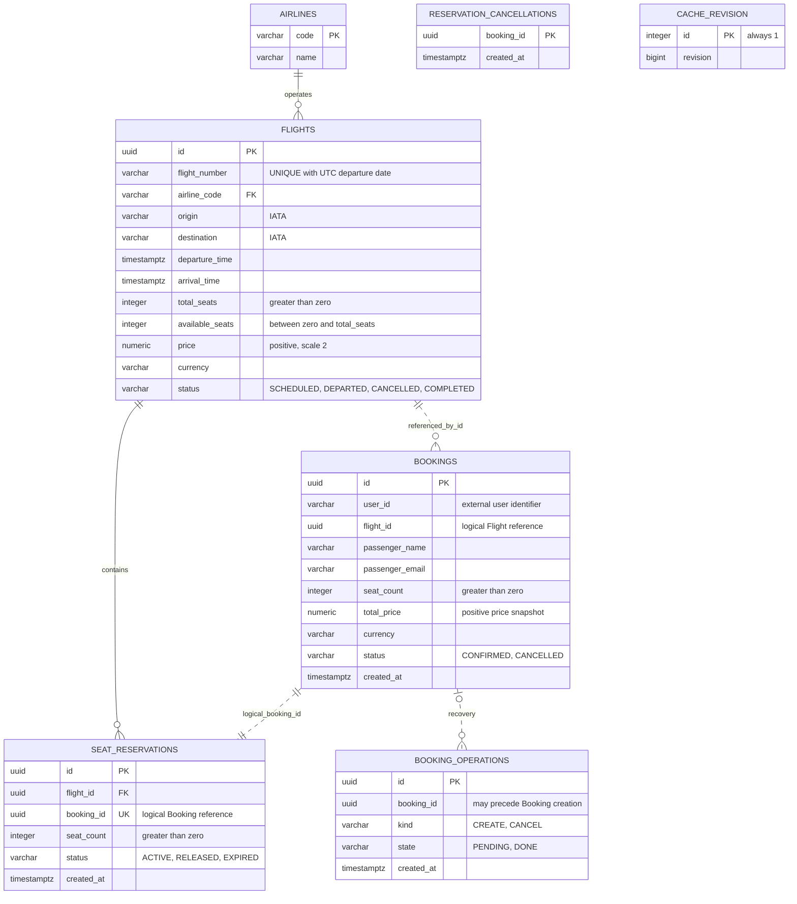

# Схема данных

`airlines`, `flights`, `seat_reservations`, `reservation_cancellations` и `cache_revision` находятся в PostgreSQL Flight Service. `bookings` и `booking_operations` находятся в отдельной PostgreSQL Booking Service. Сплошные линии обозначают локальные внешние ключи, пунктирные — логические связи через идентификаторы. Между базами нет внешних ключей и прямых запросов сервисов к чужим таблицам.

В устойчивом состоянии каждому созданному бронированию соответствует одна резервация; при компенсации неуспешной операции может остаться RELEASED-резервация без бронирования. Незавершённая операция CREATE существует до записи бронирования, поэтому `booking_operations.booking_id` намеренно не имеет FK.

Поля атомарны, неключевые атрибуты зависят от ключа своей сущности. Название авиакомпании вынесено в `airlines`: оно определяется кодом авиакомпании. Информация о маршруте не дублируется в бронировании. Данные пассажира описывают пассажира конкретной покупки; `user_id` идентифицирует покупателя и не определяет пассажира. Стоимость бронирования — самостоятельный исторический факт, она не зависит от текущей цены рейса. Отдельное поле departure_date не хранится: уникальность номера и UTC-даты задаёт функциональный индекс. Эти свойства обеспечивают 3NF.

CHECK-ограничения проверяют положительные цены и количество мест, диапазон доступных мест, допустимые статусы, форматы аэропортов и валют, разные аэропорты и порядок времён. `UNIQUE(booking_id)` запрещает две резервации одного бронирования. Счётчик доступных мест и резервация изменяются в одной транзакции с блокировкой рейса `SELECT FOR UPDATE`.

`reservation_cancellations` хранит запрет повторного резервирования для уже отменённого booking_id. Он нужен и при отсутствии резервации: отложенный ReserveSeats после таймаута не сможет заново занять места после компенсации. `cache_revision` изменяется транзакционно вместе с данными рейсов и защищает чтение кеша после сбоя Redis.
